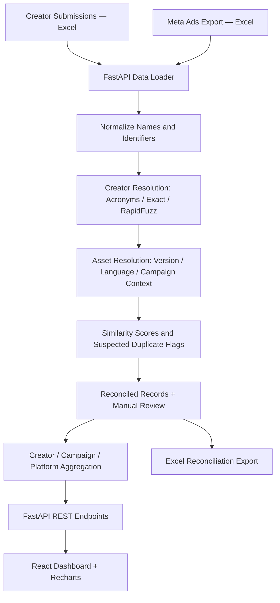

# MPL — Creator Performance Analytics & UGC Reconciliation Engine

> A full-stack, production-oriented **creator performance analytics prototype** that connects UGC creator submissions with Meta Ads exports, explains uncertain matches, and turns advertising data into actionable acquisition-efficiency insights.

**[Live Dashboard](https://mplanalytics.netlify.app)** · **[GitHub Repository](https://github.com/RachitSrivas/mpl-creator-analytics)**

**Stack:** React 18 · Vite · Tailwind CSS · Recharts · Python · FastAPI · Pandas · RapidFuzz · OpenPyXL · Pydantic

---

## 📌 Overview

Mobile Premier League (MPL) works with user-generated-content (UGC) creators to produce marketing videos. The submitted assets are later used in Meta advertising campaigns for Android and iOS. Two sources need to be connected:

1. **Creator Submissions:** creator IDs, social handles, asset IDs, filenames, and submission dates.
2. **Meta Ads Export:** ad names, campaigns, advertising spend, impressions, and attributed app installs.

The sources do not share a reliable common key. For example, a submitted video named `rummy_hook_v1.mp4` from `@rummyraja` may appear in the advertising export as `UGC_RummyRaja_HookV1_Oct`.

This project addresses **two core tasks**:

- **Reconciliation:** Associate Meta ad records with the most likely creator and submitted asset, flag potential duplicates, surface uncertain/unmatched records, and allow manual correction.
- **Performance analytics:** Aggregate advertising metrics by creator, creative, campaign, and platform to help marketing teams prioritize follow-up tests and budget-allocation decisions.

> **Scope:** The available dataset includes ad spend and attributed installs, not revenue, customer lifetime value, or profitability. Therefore, this dashboard reports *acquisition efficiency*, not ROI or ROAS.

## 🌐 Demo

- **Interactive frontend:** https://mplanalytics.netlify.app
- **Source code:** https://github.com/RachitSrivas/mpl-creator-analytics
- **API documentation when running locally:** http://localhost:8000/docs

The application loads an included MPL interview sample dataset by default; users can also upload an Excel workbook containing the two required sheets.

## 🏗️ System Architecture



**Backend:** FastAPI exposes reconciliation, summary, creator, campaign, platform, recommendation, upload, override, and export endpoints. Pandas/OpenPyXL load Excel data, and RapidFuzz supports approximate string matching.

**Frontend:** React, Vite, Tailwind CSS, Recharts, and Lucide icons provide KPI summaries, creator rankings, charts, reconciliation review, detail views, and report actions.

**State model:** The current implementation keeps the active dataset and manual overrides in **server memory**. They are not saved to a database, and restarting the backend resets them. This is an assignment prototype, not a persistent multi-user application.

---

## 🔍 Task 1 — Data Reconciliation

### 1. Text normalization

The engine standardizes inputs before matching:

- Splits CamelCase (`RummyRaja` → `Rummy Raja`; `TPTales` → `TP Tales`).
- Strips the creator-handle `@` prefix and removes case-insensitive `UGC_` prefixes.
- Removes supported file extensions such as `.mp4` and `.mov`.
- Standardizes separators and whitespace, and compares lowercase strings.

### 2. Creator identification

The engine attempts a series of match strategies:

1. **Known abbreviation expansion:** Maps examples such as `TPTales` to `@teen_patti_tales` using a configured acronym dictionary.
2. **Exact normalized handle match:** Checks whether the compact creator handle occurs in the ad name.
3. **Fuzzy match:** Applies RapidFuzz similarity to creator handles and ad names when the earlier strategies do not resolve a creator.
4. **Unmatched classification:** Leaves records without an accepted creator candidate unresolved for review (for example, an unknown test creator or non-UGC static banner).

The **minimum creator-level fuzzy match threshold is 70** in the current implementation. This is distinct from the final combined match score described below.

### 3. Asset disambiguation

A creator can submit multiple videos and run them in different campaigns. Asset selection combines:

- Version and episode markers (`v1`, `v2`, `ep1`, `ep2`, `final`).
- Language indicators (`HI` and `hindi`).
- Campaign context (`Rummy_Android` versus `Ludo_Android`).
- Filename-to-ad-name similarity.

For example, when `@desi_gamer` has both `rummy_win_reaction.mp4` and `ludo_win_reaction.mp4`, campaign context helps distinguish which video an otherwise generic `UGC_DesiGamer_Reaction` advertisement most likely refers to.

These are **heuristic matches**, not proof of perfect attribution. Analysts should review ambiguous assets.

### 4. Match scoring and review

The engine combines creator and asset match scores into an overall **heuristic similarity score**. Its displayed labels are:

| Label | Overall score | Meaning |
|---|---:|---|
| High | ≥ 85 | Stronger heuristic match; still reviewable |
| Medium | 60–84.9 | Review recommended, particularly for multiple plausible assets |
| Low | < 60 | Weak match; verify manually |
| Unmatched | No accepted creator | Creator association unavailable |

**Important:** These scores are *not statistically calibrated probabilities*. The creator-level 70-point fuzzy threshold and final overall score labels serve different purposes.

### 5. Suspected duplicate detection

The app compares fingerprints of `(ad_name, campaign, spend_inr, impressions, installs)`. A repeated fingerprint is marked as a **suspected duplicate** and excluded from aggregate metrics by default, with a manual option to restore it.

In the sample data, repeated `UGC_TPTales_Ep1` records would otherwise add **₹21,000** to reported spend. Excluding the repeated row avoids a *potential ₹21,000 overstatement*; it does **not** represent money recovered from Meta.

Identical values alone do not prove a duplicate. An ad ID, reporting window, or export-row identifier would provide stronger deduplication evidence in a real integration.

### 6. Manual reconciliation

The reconciliation center allows an analyst to review match rationale, modify the matched creator/asset, adjust exclusion status, and reset to algorithmic results. The record indicates when an override was applied.

**Current limitation:** Override changes and their state are held in memory. There is no persistent, historical, user-attributed audit log yet.

### Optional LLM helper

An experimental `backend/app/llm_fallback.py` helper can propose explanations for ambiguous matches and supports an optional Gemini key. **It is not automatically invoked by the primary `ReconciliationEngine.reconcile()` flow** in the current version. The main pipeline is deterministic and fuzzy-rule-based, rather than dependent on a hosted LLM.

---

## 📊 Task 2 — Creator Analytics

### Metric definitions

| Metric | Calculation | Interpretation |
|---|---|---|
| **Ad spend** | Sum of included Meta spend | Budget attributed to a creator/campaign |
| **Impressions** | Sum of included impressions | Number of times ads were displayed, not unique people |
| **Installs** | Sum of included attributed installs | App installs attributed by the supplied export |
| **Blended CPI** | `total_spend / total_installs` | Average acquisition cost per attributed install |
| **CPM** | `total_spend / total_impressions × 1000` | Spend per 1,000 ad impressions |
| **Impression-to-install rate** | `total_installs / total_impressions × 100%` | Installs relative to impressions; *not* click-to-install CVR |
| **Asset utilization** | Submitted assets versus assets associated with ads | Identifies unused submissions |

Ratios should be calculated from **aggregated totals**, rather than by averaging individual ad CPIs. When installs or impressions are zero, those metrics should be treated as unavailable rather than interpreted as normal performance. In the current code, some zero-denominator cases use fallback numeric values; these should be handled more explicitly in a future iteration.

### Performance classifications

The prototype uses configurable business-rule thresholds, rather than a learned model:

| Classification | Indicative rule in the project | Suggested next step |
|---|---|---|
| **High Performer** | CPI ≤ ₹35 with sufficient test volume | Consider controlled budget-increase tests |
| **Needs Review** | CPI > ₹50 with meaningful spend | Review creative, targeting, and install quality |
| **Insufficient Data** | Spend < ₹5,000 or installs < 50 | Continue collecting data before making a decision |
| **Unutilized** | No associated active ad records | Consider a small initial campaign test |

These thresholds are **illustrative project defaults**, not confirmed MPL business targets. Creator decisions should also consider campaign differences, audience quality, retention, and revenue when those data become available.

### Insights from the included interview dataset

The following are *descriptive observations from the supplied sample data* after default suspected-duplicate exclusion—not forecasts or causal findings.

| Observation | Sample finding | Practical interpretation |
|---|---|---|
| **Creator efficiency** | `@carrom_king`: ₹31.25 blended CPI across 800 installs | Candidate for a controlled scale test |
| **Creator efficiency** | `@rummyraja`: ₹32.86 blended CPI across 1,558 installs | Strong blended performance; examine each video separately |
| **Creator efficiency** | `@teen_patti_tales`: ₹31.76 CPI across 740 installs | Results account for the suspected duplicate exclusion |
| **Creator efficiency** | `@rummyrani`: ₹30.00 CPI across 300 installs | Efficient sample performance, pending quality validation |
| **Platform comparison** | Android: **~₹35.45 CPI**; iOS: **₹107.50 CPI** | Android was approximately 3× more acquisition-efficient within this particular export |
| **Localization comparison** | Carrom Hindi creative: ₹26.92 CPI vs standard creative: ₹33.33 CPI | Approximately 19.2% lower observed CPI for the Hindi variant |
| **Creative comparison** | RummyRaja Hook v1: ₹31.58 CPI vs Hook v2: ₹84.21 CPI | Review the second variant; comparison alone cannot prove creative fatigue |
| **Untested submission** | `@fruitchop_fan` submitted an asset with no associated active ad rows | Candidate for a limited pilot |

**Budget recommendation:** The Android/iOS gap suggests testing reallocation, but **incremental installs cannot be guaranteed** using historical average CPI. Marginal acquisition cost, targeting, campaign maturity, user quality, and saturation may change as budgets scale.

---

## 💻 Task 3 — Dashboard Features

- **Executive summary:** Total spend, installs, blended CPI/CPM, matching coverage, and suspected duplicate exposure.
- **Creator leaderboard:** Search, performance tiers, sort controls, and detailed creator views.
- **Interactive visualizations:** CPI versus benchmark, spend-versus-installs scatter plot, Android/iOS comparison, and campaign breakdown.
- **Reconciliation center:** Matched/unmatched records, score tiers, rationale, suspected duplicates, and manual correction controls.
- **Creator drilldown:** Per-creator submissions, associated ads, and asset-level performance.
- **Data ingestion:** Upload a workbook with creator-submission and Meta-export worksheets, replacing the in-memory active dataset.
- **Reporting:** Download an Excel workbook with reconciliation outcomes and creator-level analytics.
- **Recommendations:** Rule-based signals to support marketing review rather than automatic contract termination.

> **Data freshness:** Results reflect the current uploaded or bundled snapshot; the project does not continuously sync with Meta's APIs.

---

## 🚀 Local Setup

### Prerequisites

- Python **3.10+** (project developed for modern Python environments).
- Node.js **18+** and npm.
- Windows for the included `.bat` launcher scripts, or any OS using the manual commands below.

### Option A — Windows quick start

From the repository root:

```cmd
run_all.bat
```

This script is intended to launch the backend at `http://localhost:8000` and frontend at `http://localhost:5173`.

### Option B — Start backend manually

```bash
cd backend
python -m pip install -r requirements.txt
python -m uvicorn app.main:app --host 127.0.0.1 --port 8000 --reload
```

- Health check: http://localhost:8000/api/health
- Interactive API docs: http://localhost:8000/docs

### Start frontend manually (second terminal)

```bash
cd frontend
npm install
npm run dev
```

Open **http://localhost:5173**.

### Test the reconciliation logic

From the `backend` directory:

```bash
python test_runner.py
```

The included test code covers **eight scenarios**, including normalization, exact/fuzzy matching, acronym handling, campaign context, suspected duplicates, unmatched records, analytics, and recommendations. Run the suite locally to confirm passing status for your environment; the documentation does not substitute for a current test run.

### Input format

Upload one **`.xlsx` Excel workbook containing two worksheets**:

| Worksheet | Required columns |
|---|---|
| Creator Submissions | `creator_id`, `handle`, `asset_id`, `file_name`, `submitted_date` |
| Meta Ads Export | `ad_name`, `campaign`, `spend_inr`, `impressions`, `installs` |

Sheet names containing words such as `creator`/`submission` and `meta`/`ad`/`export` are detected by the loader. Column names are normalized for case and common separators.

**CSV limitation:** Although the upload endpoint currently lists `.csv` among allowed filename extensions, its parsing implementation expects an Excel workbook with both sheets. Use `.xlsx` for the current working flow; proper two-file CSV ingestion is a future improvement.

### Main REST endpoints

| Method | Endpoint | Purpose |
|---|---|---|
| `GET` | `/api/health` | Backend health status |
| `GET` | `/api/summary` | Overall KPI summary |
| `GET` | `/api/creators` | Creator rankings and filters |
| `GET` | `/api/creators/{creator_id}` | Creator details |
| `GET` | `/api/reconciliation` | Reconciliation records and filters |
| `POST` | `/api/reconciliation/override` | Set manual creator/asset/exclusion overrides |
| `POST` | `/api/reconciliation/reset` | Restore algorithmic matches |
| `GET` | `/api/campaigns` | Campaign aggregations |
| `GET` | `/api/platforms` | Android/iOS aggregations |
| `GET` | `/api/recommendations` | Rule-based analysis suggestions |
| `POST` | `/api/upload` | Upload a two-sheet Excel workbook |
| `POST` | `/api/reset-data` | Restore the included sample dataset |
| `GET` | `/api/export/excel` | Export reconciliation and performance report |

### Hosted frontend and backend

The React frontend uses relative `/api` requests. Locally, Vite proxies these to FastAPI; in the Netlify deployment, `/api` requests are expected to route to the deployed backend according to the site's redirect configuration. The API server must be reachable for interactive data features to work.

---

## 📁 Project Structure

```text
.
├── backend/
│   ├── app/
│   │   ├── main.py             # FastAPI endpoints and application state
│   │   ├── config.py           # Thresholds, acronym map, default data path
│   │   ├── models.py           # Pydantic schemas
│   │   ├── reconciliation.py   # Name matching and duplicate detection
│   │   ├── analytics.py        # Aggregations and rule-based recommendations
│   │   ├── data_loader.py      # Excel loading and report export
│   │   └── llm_fallback.py     # Optional standalone LLM helper
│   ├── data/                   # Interview Excel dataset
│   ├── tests/
│   │   └── test_reconciliation.py
│   ├── test_runner.py
│   ├── requirements.txt
│   └── run.py
├── frontend/
│   ├── src/
│   │   ├── components/         # KPI cards, charts, leaderboard, review UIs
│   │   ├── api.js              # HTTP API functions
│   │   ├── App.jsx
│   │   ├── index.css
│   │   └── main.jsx
│   ├── package.json
│   ├── vite.config.js
│   └── tailwind.config.js
├── start_backend.bat
├── start_frontend.bat
├── run_all.bat
└── README.md
```

## ⚠️ Current Limitations and Next Steps

This implementation demonstrates the assignment workflow end to end, but additional work would be needed before using it as a multi-user production service:

1. **Persistent storage & audit history:** Store uploads, match overrides, user IDs, and edit timestamps in a database, with versioned history and rollback.
2. **Safer duplicate identification:** Incorporate actual ad IDs, reporting periods, and export IDs rather than relying only on identical metrics.
3. **Verified reconciliation:** Label known ground-truth matches, measure precision/recall on held-out datasets, and route uncertain cases to human review.
4. **Zero-denominator handling:** Represent CPI as `N/A` when installs are zero instead of using a fallback spend value.
5. **CSV support:** Add a validated two-file CSV upload flow or remove `.csv` from the accepted endpoint extensions.
6. **Authentication and isolation:** Add sign-in, access controls, upload limits, validation, and organization-level data separation; constrain production CORS.
7. **Live Meta integration:** Pull ad performance through the authorized Meta Marketing API, with scheduled ingestion, reporting-window normalization, and error handling.
8. **Recommendations validation:** Replace illustrative uplift forecasts with experiments and measurement of install quality, retention, and incremental acquisition cost.
9. **Optional LLM integration:** Wire the experimental LLM helper into a controlled, reviewable fallback path only if it measurably improves matching quality.

---

## ✅ Assignment Deliverables

- [x] Creator/ad reconciliation with name normalization and campaign-context matching.
- [x] Flagging and default exclusion of suspected identical export rows.
- [x] Creator-level acquisition metrics, tiering, and visualizations.
- [x] Interactive review and in-memory manual override controls.
- [x] Excel workbook upload and report export.
- [x] Included test scenarios and local startup instructions.
- [ ] Persistent audit storage, proven matching accuracy on unseen data, and production security hardening.

---

